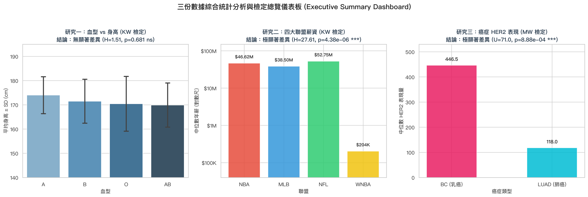

# 📊 數據統計分析與視覺化專案 (Statistical Analysis & Data Visualization)

本專案針對三組生物醫學與社會經濟統計學數據進行探索性資料分析（EDA）、假設檢定（Hypothesis Testing）、效應量（Effect Size）計算，並產出專業統計圖表、互動式 HTML 儀表板及 Word 報告文件。

---

## 📌 統計研究摘要 (Executive Summary)



### 核心檢定成果彙總表

| 數據檔案 | 應變數 (DV) | 自變數 (IV) / 分組 | 樣本數 $N$ | 建議檢定方法 | 檢定統計量 | $p$-value | 統計顯著性 | 結論與效應量 |
| :--- | :--- | :--- | :--- | :--- | :--- | :--- | :--- | :--- |
| **`KW_Blood type.xlsx`** | 身高 `Height (cm)` | 血型 (`A`, `B`, `O`, `AB`) | 44 | **Kruskal-Wallis 檢定**<br>(參照: One-way ANOVA) | $H = 1.5070$<br>($F = 0.4600$) | $0.6806$<br>($0.7118$) | **不顯著 ($ns$)** | 血型與身高無任何統計顯著差異 ($\eta^2 = 0.033$) |
| **`KW_Pro_salary.xlsx`** | 年薪 `Salary (Annual)` | 職業聯盟 (`NBA`, `MLB`, `NFL`, `WNBA`) | 40 | **Kruskal-Wallis 檢定**<br>(事後 Dunn's 檢定) | $H = 27.6106$ | $4.38 \times 10^{-6}$ | **極顯著 ($***$)** | WNBA 與三大男子聯盟具高達 234 倍性別薪資落差 ($\epsilon^2 = 0.708$) |
| **`Mann whitney.xlsx`** | HER2 表現量 `HER2_level` | 癌症分類 (`BC` 乳癌 vs `LUAD` 肺癌) | 17 | **Mann-Whitney U 檢定**<br>(Wilcoxon Rank-Sum) | $U = 71.0$<br>($W = 107.0$) | $8.88 \times 10^{-4}$ | **極顯著 ($***$)** | 乳癌 HER2 表現量顯著高於肺腺癌，效應量 Cliff's $\delta = 0.972$ |

---

## 🔬 研究專案細節

### 1. 血型與身高關聯性分析 (`KW_Blood type.xlsx`)
- **分析方法**：Shapiro-Wilk 常態性檢定、Levene 變異數同質性檢定、單因子變異數分析 (ANOVA) 與 Kruskal-Wallis 檢定。
- **結論**：各組身高皆符合常態分佈且變異數齊一，檢定未達顯著標準 ($p > 0.05$)。結果符合遺傳學機制（ABO 位於第 9 號染色體單一基因座，身高為多基因遺傳）。
- **圖表**：`figure1_blood_type_height.png`

### 2. 職業運動年薪結構與性別差距研究 (`KW_Pro_salary.xlsx`)
- **分析方法**：四大聯盟（NBA、MLB、NFL、WNBA 各 10 位頂薪球員）Kruskal-Wallis 檢定與 Dunn's 事後檢定（Bonferroni 校正）。
- **結論**：三大男子聯盟內部薪資無顯著差異，但與 WNBA 存在高達 233.9 倍之懸殊薪資落差 ($p < 0.001$)；NBA 內部年齡與年薪呈現顯著正相關 ($r_s = 0.675, p = 0.0322$)。
- **圖表**：`figure2_pro_salary_analysis.png`

### 3. 乳腺癌 vs 肺腺癌之 HER2 表現量檢定 (`Mann whitney.xlsx`)
- **分析方法**：Mann-Whitney U 檢定、Wilcoxon 秩和檢定、Cliff's Delta 效應量計算。
- **結論**：乳腺癌組（BC）HER2 表現量顯著高於肺腺癌組（LUAD）($U = 71.0, p = 8.88 \times 10^{-4}$)，Cliff's $\delta = 0.9722$，常態語言效應量 CLES = 98.6%。
- **圖表**：`figure3_mann_whitney_her2.png`

---

## 📁 專案檔案結構

```text
.
├── README.md                              # 專案說明文件
├── .gitignore                             # Git 忽略設定
├── KW_Blood type.xlsx                     # 血型與身高數據
├── KW_Pro_salary.xlsx                     # 職業運動員薪資數據
├── Mann whitney.xlsx                      # 乳腺癌與肺腺癌 HER2 數據
├── generate_charts.py                     # 產出高品質統計圖表 Python 腳本
├── generate_html.py                       # 產生互動式 HTML 報告 Python 腳本
├── generate_word_report.py                # 匯出專業 Word 報告 (.docx) 腳本
├── analysis_report.html                   # 現代化互動式網頁報告
├── 123資料夾數據統計分析報告.docx          # 中文排版 Word 報告
├── Statistical_Analysis_Report_123.docx   # 英文檔名對應 Word 報告
├── figure1_blood_type_height.png          # 研究一統計圖
├── figure2_pro_salary_analysis.png        # 研究二統計圖
├── figure3_mann_whitney_her2.png          # 研究三統計圖
└── figure4_summary_dashboard.png          # 綜合儀表板總覽圖
```

---

## 🚀 執行與重現步驟

### 1. 安裝必要套件
```bash
pip install pandas numpy scipy matplotlib seaborn python-docx openpyxl scikit-posthocs
```

### 2. 重新產出圖表與報告
```bash
# 產出統計圖表 PNG
python3 generate_charts.py

# 產出 HTML 互動式報告
python3 generate_html.py

# 產出 Word 報告文件
python3 generate_word_report.py
```
